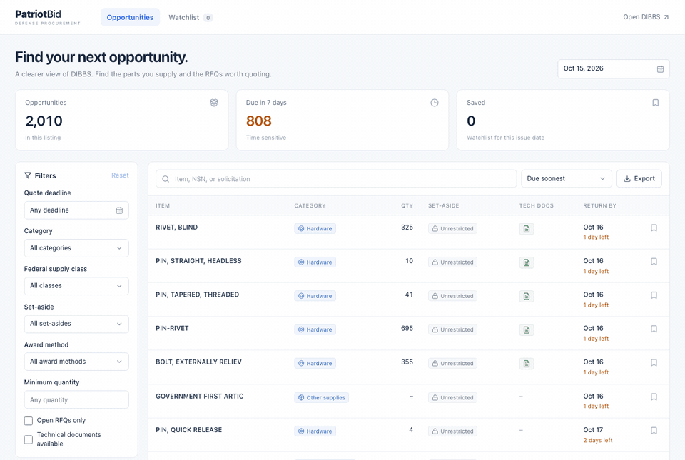
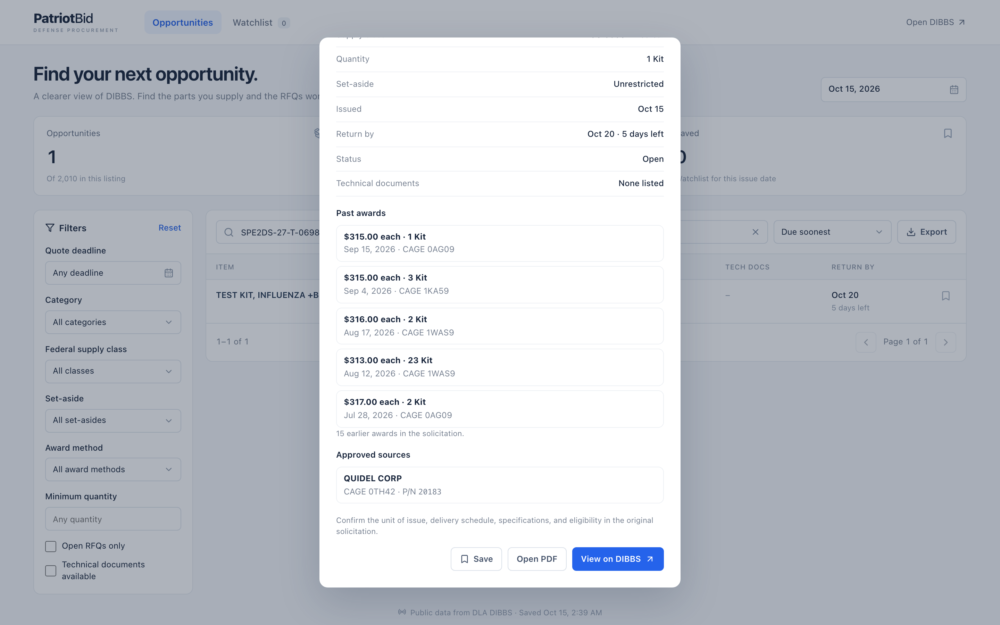
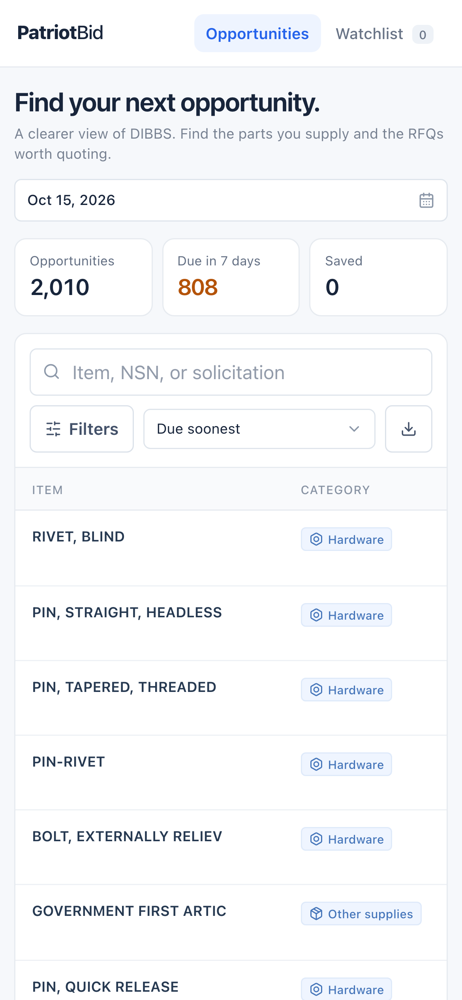
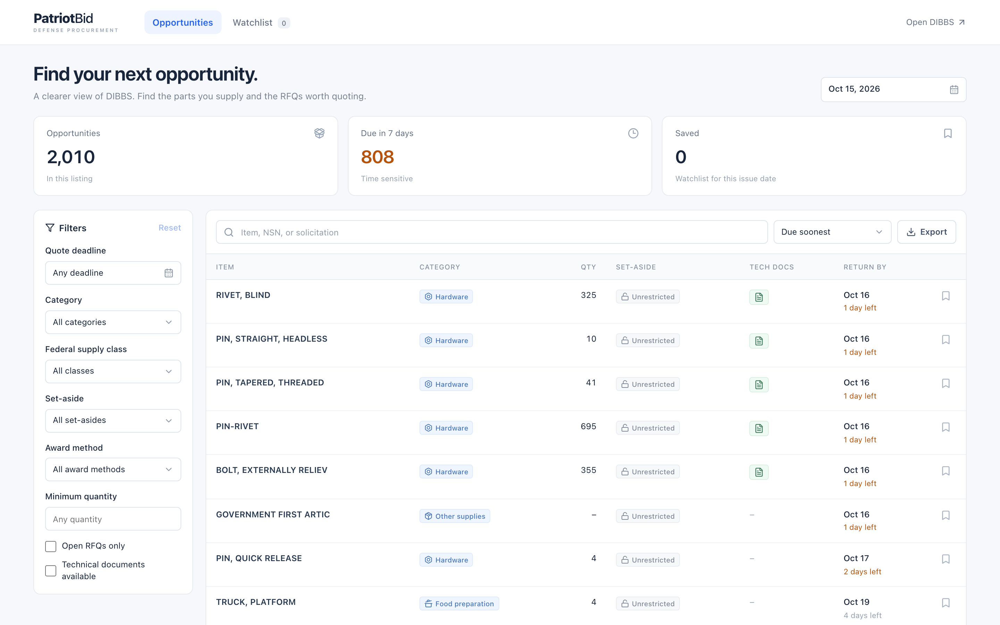

# PatriotBid

**A free, clearer view of DIBBS, the Defense Logistics Agency's bid board.** Find the military parts you can supply, see what the government paid last time, and spot the RFQs worth quoting.

**[Try it live](https://patriotbid-f8edb2776ee7.herokuapp.com/)** · No account, no login, no paywall.



## Why

DLA posts around 2,000 requests for quotes (RFQs) on [DIBBS](https://www.dibbs.bsm.dla.mil/) every business day. The data is public, but the site is hard to read: raw government codes, no useful filters, and the details that decide whether a bid is worth it (past prices, approved suppliers, units) are buried in a PDF.

Paid tools fix this for hundreds to thousands of dollars a year. PatriotBid does the core of it for free.

## Features

- **Plain English everywhere.** Supply class codes become categories like *Hardware* or *Medical*, set-asides get readable badges, unit codes become *Each* or *Kit*, and the solicitation number is translated into how the winner is picked (*Automated, lowest price wins* or *Reviewed by a buyer*).
- **Past award prices.** Every RFQ shows what DLA paid before: unit price, quantity, date and winning CAGE code, read straight from the solicitation's procurement history.
- **Approved sources.** The suppliers and part numbers DLA will accept, pulled from the solicitation PDF.
- **One-click tech docs.** The green icon opens the drawings and specs on DLA's technical data site.
- **Real filters.** Category, supply class, set-aside, award method, deadline, minimum quantity, open only, and tech docs available. Search by item name, NSN (with or without dashes), or solicitation number.
- **Watchlist and CSV export.** Save RFQs in your browser and export any filtered view.
- **Works on phones.** The full table scrolls sideways; the details open as a bottom sheet.

| Details popup | On a phone |
|---|---|
|  |  |



## How it works

```
DIBBS daily listing ──► Cheerio parser ──► database ──► Next.js API ──► React table
DIBBS solicitation PDF ──► unpdf ──► approved sources, unit, award history (cached per NSN)
```

- The server opens DIBBS's public notice page, keeps the session cookies, accepts the notice the same way a browser does, and reads the daily RFQ grid page by page. No logins or verification challenges are bypassed.
- Requests to DIBBS are rate limited to one per second, and each issue date is stored once it's complete, so repeat visitors never hit DIBBS again for the same day.
- The first time anyone opens an item, its solicitation PDF is read for approved sources, unit of issue and past awards. The result is cached by NSN.
- Nothing is invented. Fields DIBBS doesn't provide stay blank, and every popup links back to the original PDF and DIBBS page.

Built with Next.js, React, TypeScript, Cheerio, unpdf and plain CSS. Storage is Postgres when `DATABASE_URL` is set, otherwise a local SQLite file.

## Run it yourself

Requires Node.js 22.

```sh
npm install
npm run dev
```

Open http://127.0.0.1:3000. For production: `npm run build`, then `npm start`.

### Environment variables

All optional.

| Variable | What it does |
|---|---|
| `DATABASE_URL` | Postgres connection string. Without it, data is stored in `data/rfqs.sqlite`. |
| `RFQ_DB_PATH` | Custom path for the SQLite file. |
| `MOUSER_API_KEY` | Enables product photos for approved part numbers via the Mouser API. |

### Deploy

Any Node.js host works: it runs `npm run build`, then `npm start`, which listens on `$PORT`. Set `DATABASE_URL` to a Postgres database so stored listings survive restarts.

## Tests

```sh
npm test               # parser, filters, storage and API route tests
npm run typecheck
npm run build
npx tsx tests/live-check.ts   # optional: checks paging against live DIBBS
```

The parser tests run against a real DIBBS page captured as a fixture in `tests/`.

## Disclaimer

PatriotBid is an independent project and is not affiliated with the Defense Logistics Agency or the U.S. government. Always confirm requirements, eligibility and deadlines in the original solicitation before you quote.
